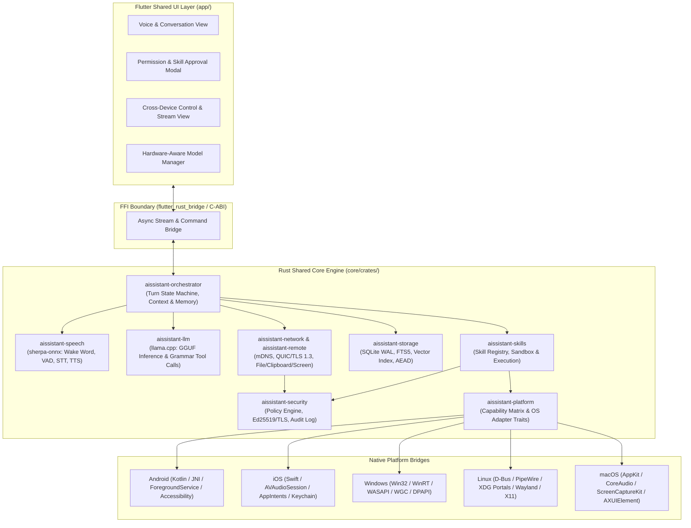

# ARCHITECTURE.md — Universal AI Assistant System Architecture

## 1. Architectural Vision

The **Universal AI Assistant** (`aissistant`) is a unified, offline-first, voice-first personal AI and cross-device automation platform running natively on **Android, Windows, Linux, macOS, and iOS**.

All business logic, AI orchestration, speech processing, model lifecycle management, encrypted storage, skill policy enforcement, and peer-to-peer networking reside in a shared **Rust Core Engine** (`core/`). The **Flutter Application Layer** (`app/`) provides a single reactive, accessible UI across all five platforms, while thin **Native Platform Bridges** (Kotlin, Swift, Win32/WinRT, Linux D-Bus/Portals, macOS AppKit/Accessibility) expose OS-specific capabilities with runtime capability detection and graceful degradation.

---

## 2. High-Level System Topology



---

## 3. Repository & Module Layout

```text
g:\aissistant/
├── AGENTS.md                        # Global agent charter & team responsibilities
├── CLAUDE.md                        # Behavioral & surgical coding guidelines
├── ENGINEERING_CONTRACT.md          # Binding quality, safety & verification gates
├── ARCHITECTURE.md                  # System architecture & data flows
├── REQUIREMENTS.md                  # Functional/non-functional specs & platform matrix
├── SECURITY.md                      # Threat model, permissions & crypto design
├── ROADMAP.md                       # Stages 0-11, phases & numbered subphases
├── EXECUTION_STATUS.md              # Live subphase completion & verification tracker
├── TODO.md                          # Append/update task backlog with preserved history
├── CHANGELOG.md                     # Append-only implementation log
├── TESTING.md                       # Verification strategy, coverage & test harnesses
├── CONTRIBUTING.md                  # Developer onboarding & workflow guide
├── README.md                        # Project overview & quickstart
├── .agent/
│   ├── rules/                       # Mandatory execution, quality, security & testing rules
│   ├── skills/                      # 11 specialized domain agent skills
│   └── workflows/                   # Implementation, review, testing & release workflows
├── .github/
│   └── workflows/                   # Multi-platform CI, security audit & release pipelines
├── docs/
│   ├── SETUP.md                     # Toolchain setup per host OS
│   └── USER_GUIDE.md                # End-user operation & privacy guide
├── core/                            # Rust Workspace (Created in Stage 0 / Stage 1)
│   ├── Cargo.toml
│   └── crates/
│       ├── aissistant-core/         # Domain types, config, errors, capability descriptors
│       ├── aissistant-storage/      # SQLite WAL, FTS5, vector search, AEAD encryption
│       ├── aissistant-security/     # PolicyEngine, Ed25519 identity, OS keystore, audit log
│       ├── aissistant-audio/        # Lock-free audio ring buffers, capture/playback traits
│       ├── aissistant-speech/       # sherpa-onnx wake-word, VAD, streaming STT, neural TTS
│       ├── aissistant-llm/          # llama.cpp bindings, hardware profiler, model manager
│       ├── aissistant-orchestrator/ # Conversation state machine, memory retrieval, tool loop
│       ├── aissistant-skills/       # Built-in & extensible skills, sandboxed runner
│       ├── aissistant-platform/     # OS-specific adapters (Windows, Linux, macOS, Android, iOS)
│       ├── aissistant-network/      # mDNS discovery, QUIC/TLS 1.3 transport, pairing protocol
│       ├── aissistant-remote/       # Cross-device RPC, file transfer, clipboard, screen stream
│       └── aissistant-ffi/          # flutter_rust_bridge API surface
└── app/                             # Flutter Multi-Platform App Shell (Created in Stage 1)
    ├── pubspec.yaml
    ├── lib/
    ├── android/
    ├── ios/
    ├── windows/
    ├── linux/
    └── macos/
```

---

## 4. Core Component Specifications

### 4.1 Offline Voice & Audio Pipeline (`aissistant-audio` + `aissistant-speech`)
1. **Audio Capture & Ring Buffer:** Captures 16 kHz, 16-bit mono PCM audio into a lock-free in-memory ring buffer (default 5-second rolling window). Raw ambient audio is never written to disk.
2. **Wake-Word Engine (`sherpa-onnx` KWS):** Continuously scans the rolling buffer using customizable open-vocabulary phoneme/pinyin/BPE keyword lists (e.g., `"Hey Assistant"`, user-defined phrases) with adjustable sensitivity thresholds.
3. **Voice Activity Detection (VAD):** Upon wake-word trigger or push-to-talk activation, VAD (`silero-vad` via ONNX) segments active speech, detects end-of-utterance, and supports **barge-in** (immediately cancelling ongoing TTS playback or LLM generation when the user speaks).
4. **Streaming STT (`sherpa-onnx`):** Supports streaming transducer (Zipformer) and non-streaming/chunked multilingual models (Whisper/SenseVoice/Paraformer ONNX) with automatic language identification.
5. **Offline Neural TTS (`sherpa-onnx`):** Synthesizes natural speech locally using VITS/Piper ONNX models, streaming sentence-by-sentence PCM chunks directly to the playback buffer to minimize time-to-first-audio (<200 ms).

### 4.2 Local LLM Runtime & Hardware Profiler (`aissistant-llm`)
1. **Hardware Discovery:** Queries CPU instruction sets (AVX2, AVX-512, ARM NEON, dotprod), system RAM, thermal state, and GPU/accelerator backends (Vulkan, Apple Metal, NVIDIA CUDA) at startup.
2. **Hardware-Aware Model Selection:** Recommends optimal quantization and parameter tiers based on available memory:
   - **Tier 1 (Ultra-Light / Mobile <4 GB free RAM):** 0.5B–1.5B Q4_K_M GGUF (~400 MB–1.1 GB)
   - **Tier 2 (Standard Mobile / Laptop 4–8 GB free RAM):** 3B–4B Q4_K_M GGUF (~2.0–2.8 GB)
   - **Tier 3 (Desktop / Workstation >8 GB free RAM/VRAM):** 7B–14B+ Q4_K_M / Q5_K_M GGUF
3. **Verified Model Registry:** Resumable HTTP range downloads with mandatory SHA-256 verification and GGUF header validation before memory-mapping (`mmap`).
4. **Grammar-Constrained Tool Calling:** Uses `llama.cpp` GBNF grammars compiled dynamically from registered skill JSON schemas so local models emit syntactically valid tool calls or direct conversational responses without hallucinated tool syntax.

### 4.3 AI Orchestration, Personal Memory & Knowledge (`aissistant-orchestrator` + `aissistant-storage`)
1. **Deterministic Turn State Machine:**
   `Idle` -> `ListeningWakeWord` -> `CapturingUtterance` -> `Transcribing` -> `RetrievingContext` -> `GeneratingResponse` -> (`AwaitingToolConfirmation` -> `ExecutingTool`) -> `SynthesizingSpeech` -> `Idle`.
2. **Hybrid Personal Memory (SQLite):**
   - **Episodic Memory:** Conversation turns indexed via SQLite **FTS5** (BM25 keyword retrieval).
   - **Semantic Memory & Personal Knowledge Base:** Local embedding generation (via lightweight ONNX/GGUF embedding model) stored in SQLite vector tables for hybrid RRF (Reciprocal Rank Fusion) retrieval over user notes, indexed documents, and preferences.
   - **Encryption at Rest:** Sensitive tables (personal facts, device credentials, clipboard history, audit logs) are encrypted with AEAD (`XChaCha20-Poly1305`) using a master key sealed in the OS hardware keystore.

### 4.4 Permission-Gated Skill Framework (`aissistant-skills` + `aissistant-security`)
Every skill implements the Rust `Skill` trait:
```rust
pub trait Skill: Send + Sync {
    fn descriptor(&self) -> &SkillDescriptor;
    fn validate_args(&self, args: &serde_json::Value) -> Result<(), SkillError>;
    fn execute(&self, ctx: &SkillContext, args: serde_json::Value) -> BoxFuture<'_, Result<SkillOutput, SkillError>>;
}
```
- **Risk Classification:** `ReadOnly`, `StateModifying`, `PrivilegedSystem`, `Destructive`, `CrossDevice`.
- **Execution Flow:** LLM emits structured tool call -> `SkillRegistry::validate_args` -> `PolicyEngine::evaluate` -> If `RequireConfirmation`, prompt user via UI/voice -> Execute with timeout & resource sandbox -> Record cryptographic hash-chained entry in `audit_log`.

### 4.5 Secure Cross-Device Discovery, Pairing & Control (`aissistant-network` + `aissistant-remote`)
1. **Discovery:** mDNS-SD (`_aissistant._udp.local.`) advertises an ephemeral node UUID, protocol version, and capability bitmask.
2. **Pairing Ceremony:**
   - Ephemeral TLS 1.3 handshake over QUIC (`quinn`).
   - Both devices derive a 6-digit Short Authentication String (SAS) and QR payload from the TLS exporter material (`RFC 5705` / `RFC 8446`) bound to both peers' Ed25519 public keys.
   - Upon mutual user confirmation, each device pins the peer's Ed25519 certificate and assigns fine-grained per-peer permissions in SQLite.
3. **Multiplexed QUIC Channels:**
   - **Control Stream (Bidirectional Reliable):** JSON-RPC / MessagePack signed skill invocations, status telemetry, and remote task orchestration.
   - **Clipboard Channel:** Opt-in encrypted text/image clipboard synchronization.
   - **File Transfer Streams:** Chunked (1 MB chunks), parallel, resumable file transfer with per-chunk BLAKE3/SHA-256 verification and atomic rename upon completion.
   - **Screen Streaming Channel:** Hardware-accelerated screen capture (Windows Graphics Capture, PipeWire Portal, ScreenCaptureKit, Android MediaProjection, iOS ReplayKit broadcast) encoded to low-latency frames over QUIC with optional permission-gated remote input injection.

---

## 5. End-to-End Data Flows

### 5.1 Offline Voice Command -> Local Skill Execution
1. Microphone PCM frames enter `AudioRingBuffer`.
2. `WakeWordDetector` detects wake phrase -> plays subtle local chime -> transitions orchestrator to `CapturingUtterance`.
3. `StreamingSttEngine` transcribes speech until `VadEngine` signals end-of-speech.
4. `Orchestrator` retrieves relevant episodic/semantic memories from `SqliteStore` and builds prompt with active `SkillDescriptor` schemas.
5. `LlamaEngine` streams response tokens; if a tool call is emitted, `PolicyEngine` checks permission policy.
6. If approved, `SkillExecutor` invokes the native platform adapter (`aissistant-platform`), receives structured output, feeds result back to `LlamaEngine`, and streams final text chunks to `TtsEngine` for spoken feedback.

### 5.2 Cross-Device Command ("Send this file to my desktop and open it")
1. Local `Orchestrator` resolves target peer (`"desktop"`) from `DeviceRegistry`.
2. Verifies active mutual-TLS QUIC session with pinned Ed25519 certificate (or wakes connection via LAN IP / configured tunnel).
3. Initiates chunked file transfer over QUIC stream; target peer verifies local policy (`AllowFileReceive` / user confirmation) and verifies SHA-256 digest.
4. Local node dispatches remote skill `file.open` over the control stream; target peer's `PolicyEngine` validates peer ACL, executes `open` via OS adapter, logs to both peers' audit logs, and returns confirmation.
