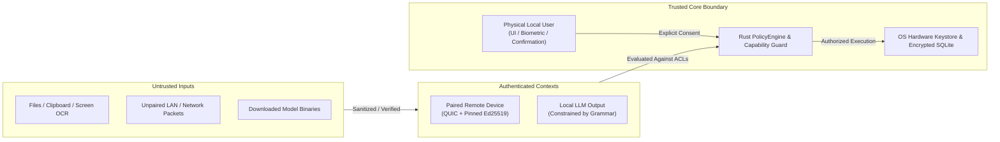

# SECURITY.md — Threat Model, Permissions & Security Architecture

## 1. Security Philosophy

The Universal AI Assistant combines local natural-language reasoning with OS automation and cross-device control. Consequently, **security and privacy are architectural invariants, not optional add-ons**:
- **Offline by Default:** No cloud account, no telemetry, no external data exfiltration.
- **Least Privilege & Fail-Closed:** Every skill and peer action defaults to `Deny` or `RequireConfirmation` unless explicitly permitted by policy.
- **Defense in Depth:** Cryptographic authentication, process/path sandboxing, structured argument validation, and tamper-evident audit logging work together so a single layer's failure cannot compromise the host.

---

## 2. Trust Boundaries

1. **Boundary 1 — Network Edge:** Any packet on UDP/QUIC or mDNS is untrusted until verified via mutual TLS 1.3 against a pinned Ed25519 certificate in the local `DeviceRegistry`.
2. **Boundary 2 — Model & Asset Supply Chain:** Downloaded `.gguf` and `.onnx` files are untrusted until their cryptographic SHA-256 digest matches the pinned manifest and their structural headers pass bounds validation.
3. **Boundary 3 — LLM Reasoning vs. Tool Execution:** The local LLM is treated as an **untrusted deputy** when processing external data (documents, clipboard, screen text). LLM tool calls cannot bypass the deterministic Rust `PolicyEngine`.
4. **Boundary 4 — Cross-Device Peer Boundary:** Even a paired device operates under a per-device Capability ACL (`PeerPermissions`), not blanket root/user equivalence.

---

## 3. Threat Model & Mitigations (STRIDE)

| Threat ID | Threat Scenario | Category | Mandatory Mitigation |
| :--- | :--- | :--- | :--- |
| **T-01** | **Indirect Prompt Injection:** Malicious text in a local file, clipboard, or screen OCR instructs the LLM to delete files or exfiltrate data to a peer. | Elevation of Privilege / Tampering | 1. Wrap untrusted external data in explicit XML/JSON data tags with system instructions forbidding instruction-following from data blocks. 2. Taint-track conversation turns containing untrusted external data: when tainted, any `StateModifying`, `PrivilegedSystem`, `Destructive`, or `CrossDevice` skill automatically escalates to mandatory local user confirmation (`RequireConfirmation`). |
| **T-02** | **Rogue LAN Peer / Man-in-the-Middle (MITM):** An attacker on the same Wi-Fi attempts to impersonate a paired desktop/phone or intercept pairing. | Spoofing / Information Disclosure | 1. Mutual TLS 1.3 over QUIC with Ed25519 certificates. 2. Pairing binds both devices' public keys into a TLS exporter Short Authentication String (SAS) / QR code verified out-of-band by the user. 3. Rate-limit failed pairing attempts with exponential backoff. |
| **T-03** | **Command Injection & Path Traversal in Skills:** LLM emits `../../Windows/System32` or shell metacharacters (`; rm -rf /`) in skill parameters. | Tampering / Elevation of Privilege | 1. Skills never invoke a shell (`sh -c`, `cmd /c`) for structured tasks; process spawning uses direct executable paths and argument arrays. 2. File skills canonicalize paths (`std::fs::canonicalize` / safe path resolver), reject symlinks escaping allowed roots, and enforce an explicit directory allowlist/denylist. |
| **T-04** | **Compromised or Corrupted Model File:** Tampered GGUF/ONNX download causes buffer overflow or arbitrary code execution. | Tampering / Denial of Service | 1. Enforce HTTPS TLS 1.3 downloads + mandatory SHA-256 verification before moving out of `.part` staging. 2. Validate GGUF/ONNX tensor dimensions and metadata bounds before passing to C/C++ FFI. |
| **T-05** | **Unauthorized Ambient Audio Recording:** Microphone stays hot without user awareness or writes ambient audio to disk. | Information Disclosure | 1. Wake-word audio uses a small, non-persistent, in-memory ring buffer zeroized on stop. 2. Mandatory visual/tray/foreground-service microphone indicator whenever audio capture is active. 3. Hardware/software mute toggle immediately drops the audio input stream handle. |
| **T-06** | **Local Data Theft at Rest:** Stolen laptop or backup exposes personal memories, audit logs, or peer private keys. | Information Disclosure | 1. Ed25519 private keys and SQLite encryption keys are stored in OS hardware-backed keystores (Windows DPAPI, macOS/iOS Keychain, Android Keystore, Linux SecretService). 2. Sensitive SQLite columns/tables use AEAD (`XChaCha20-Poly1305`) encryption; in-memory keys implement `ZeroizeOnDrop`. |

---

## 4. Permission Tiers & Policy Engine

Every skill action and remote command is assigned one of five immutable base risk tiers:

| Tier | Name | Examples | Default Local Policy | Default Remote Peer Policy |
| :--- | :--- | :--- | :--- | :--- |
| **0** | `ReadOnly` | Get time, battery status, current media track, read memory | `Allow` | `Allow` (if peer granted telemetry scope) |
| **1** | `StateModifying` | Set timer/alarm, play/pause media, adjust volume, create note | `Allow` (with undo/toast) | `RequireConfirmation` (configurable per peer to `Allow`) |
| **2** | `FileAndApp` | Launch app, write/move file in workspace, read clipboard | `RequireConfirmation` (or `Allow` within scoped folder) | `RequireConfirmation` |
| **3** | `PrivilegedSystem` | Screen capture/streaming, window automation, input injection, network config | `RequireConfirmation` (per session + visible indicator) | `RequireConfirmation` (explicit per-session grant) |
| **4** | `Destructive` | Delete files, kill processes, unpair devices, purge memory | `RequireConfirmation` (Always — cannot be set to silent `Allow` when context is tainted) | `Deny` (by default; requires explicit local confirmation) |

---

## 5. Tamper-Evident Audit Logging

All policy evaluations, skill executions, pairing attempts, and remote sessions are appended to the `security_audit_log` SQLite table:
- Each row contains: `id`, `timestamp_utc`, `actor` (`local_user`, `llm_orchestrator`, `peer:<device_id>`), `skill_id`, `arguments_redacted_json`, `policy_decision`, `execution_status`, `prev_hash`, and `entry_hash` (`BLAKE3(prev_hash || row_canonical_bytes)`).
- Any tampering or deletion of historical audit rows breaks the hash chain and triggers an integrity warning in the Security Dashboard.

---

## 6. Vulnerability Reporting & Dependency Hygiene

- All Rust dependencies are audited via `cargo audit` and `cargo deny` (checking licenses, advisories, and banned crates) in CI.
- Security defects discovered during development or testing are treated as release blockers under `ENGINEERING_CONTRACT.md`.
