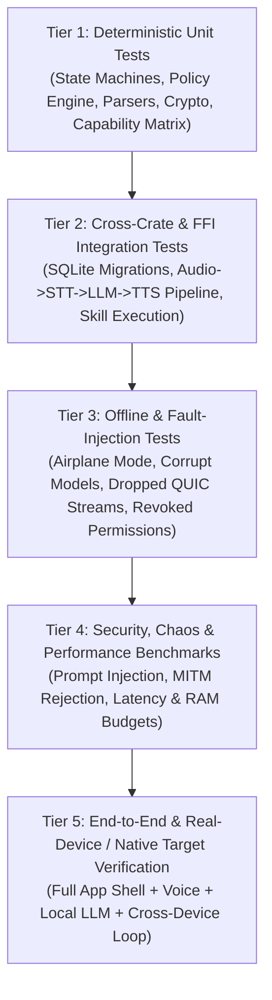

# TESTING.md — Verification Strategy, Quality Gates & Test Architecture

## 1. Testing Philosophy

In compliance with [`ENGINEERING_CONTRACT.md`](./ENGINEERING_CONTRACT.md):
- **Code coverage is necessary but not sufficient:** We require **>=90% meaningful automated test coverage** on core logic and **100% passing required tests**, backed by behavioral assertions, negative/fault-injection tests, and real integration verification.
- **Zero Mocks for Core Infrastructure:** SQLite tests run against real SQLite databases (in-memory or temp-dir WAL); crypto tests use real Ed25519/XChaCha20/TLS primitives; QUIC tests run over real loopback UDP sockets; FFI and inference tests validate real binary headers and state transitions.

---

## 2. Test Pyramid & Verification Tiers



### Tier 1: Deterministic Unit Tests (`cargo test --lib`, `flutter test`)
- **Scope:** Every Rust crate module and Flutter state controller/widget.
- **Requirements:**
  - Test both happy paths and every `Err(...)` variant.
  - Property-based testing (`proptest`) for GBNF grammar generators, path canonicalization, chunked file reassembly, and audit hash chains.

### Tier 2: Integration Tests (`core/crates/*/tests/`)
- **Storage Integration:** Schema migrations, concurrent WAL readers/writers, FTS5 ranking, vector similarity search, and AEAD encryption/decryption round-trips.
- **Speech & Audio Pipeline:** Feed deterministic 16 kHz PCM WAV fixtures into the ring buffer -> verify wake-word activation, VAD segmentation, STT transcription, and TTS PCM output generation.
- **LLM & Orchestrator Pipeline:** Verify hardware profiler detection, GGUF header/SHA-256 validation, grammar-constrained JSON tool call parsing, and multi-turn conversation state transitions.
- **Cross-Device Loopback:** Spawn two full `aissistant-network` + `aissistant-remote` nodes on `127.0.0.1:0` -> execute pairing ceremony -> verify remote skill execution, clipboard sync, and multi-chunk file transfer.

### Tier 3: Offline & Fault-Injection Tests
- **Strict Offline Verification:** Run full inference, speech, memory, and skill suites with no external network sockets permitted (loopback only).
- **Corrupt Artifact Handling:** Feed truncated `.gguf` files, bit-flipped `.onnx` files, and mismatched SHA-256 manifests -> assert clean `ModelVerificationError` without panic or UB.
- **Interrupted Network & I/O:** Drop UDP packets / kill QUIC streams mid-file-transfer -> assert resumption from the last verified chunk and zero partial corrupt files committed to destination.
- **Revoked OS Permissions:** Simulate denied microphone, file, or accessibility permissions -> assert fail-closed policy response and clear UI state degradation.

### Tier 4: Security & Adversarial Tests
- **Path Traversal Suite:** Attempt `../`, symlink escapes, UNC paths (`\\server\share`), and null-byte injection across all file skills.
- **Command Injection Suite:** Attempt shell metacharacters (`&`, `|`, `;`, `` ` ``, `$()`) in application launch and system skills.
- **Prompt Injection Taint Suite:** Inject adversarial instructions inside simulated file/clipboard inputs -> verify the orchestrator marks the turn as tainted and forces `RequireConfirmation` before any state-modifying or cross-device tool call.
- **Cryptographic Rejection Suite:** Attempt QUIC connections with expired, self-signed unpinned, or wrong-SAS certificates -> assert immediate TLS handshake termination.

### Tier 5: Performance & Resource Benchmarks
- **Wake-Word & VAD Latency:** Benchmark processing time per 20 ms audio frame (<1 ms CPU time per frame).
- **Memory Ceiling Enforcement:** Verify that idle memory stays within budget (<80 MB desktop / <60 MB mobile) and that unloading an LLM releases mapped pages deterministically.

---

## 3. Acceptance Evidence Template

Every subphase completion report in [`EXECUTION_STATUS.md`](./EXECUTION_STATUS.md) must record evidence using this structure:

```markdown
### Verification Evidence — S{stage}.P{phase}.{subphase}
- **Host / Runner OS:** Windows / Linux / macOS / Android / iOS
- **Commands Executed:**
  1. `cargo fmt --all -- --check` -> Exit 0
  2. `cargo clippy --workspace --all-targets -- -D warnings` -> Exit 0
  3. `cargo test --workspace` -> Exit 0 (X passed, 0 failed)
  4. `flutter analyze` & `flutter test` -> Exit 0 (Y passed, 0 failed)
- **Coverage Summary:** XX.X% line coverage on target modules
- **Security & Negative Tests Verified:** [List specific negative/security test names]
- **Platform Certification Status:** [HOST_VERIFIED / CI_VERIFIED / PENDING_TARGET_HARDWARE]
- **Commit Reference:** `<git-sha>`
```
